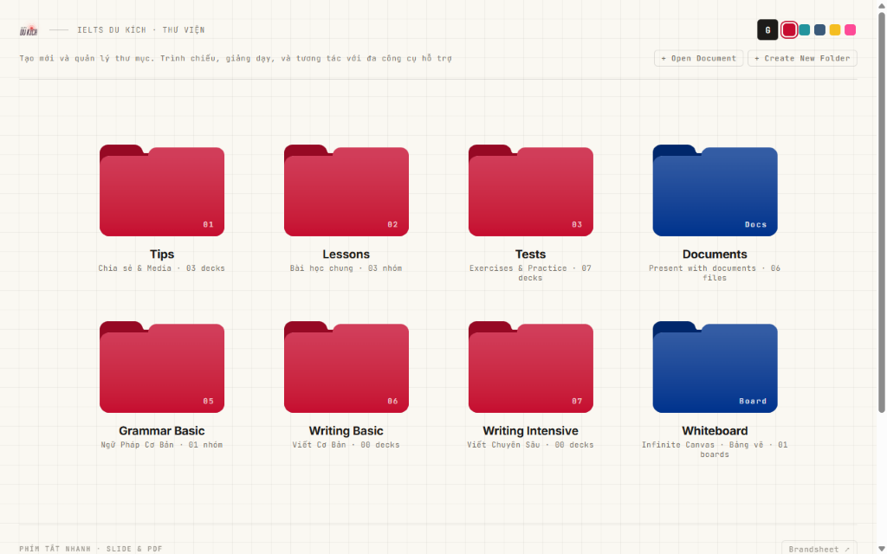
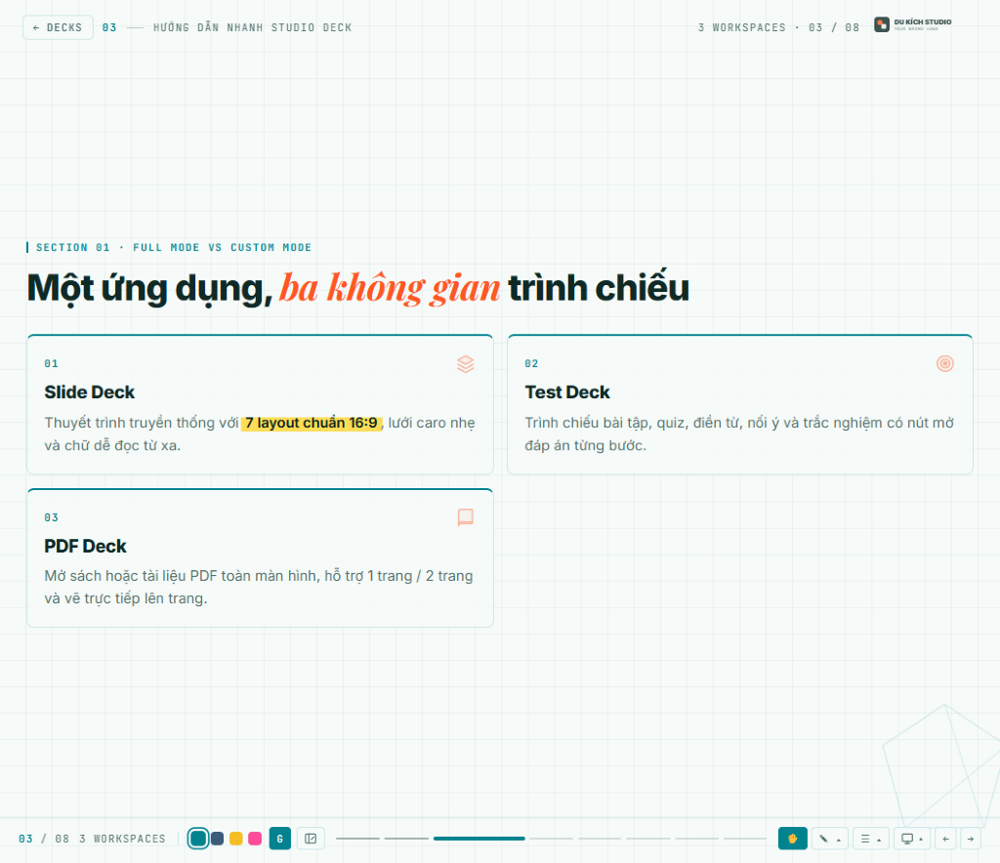

# Du Kích Studio (`dukich-studio`)

**Local-first editorial slide presenter, document viewer (PDF / Word / PowerPoint), interactive quiz engine, and infinite whiteboard built for teachers, trainers, and presenters.**

[](LICENSE)
[](https://vite.dev/)
[](#project-structure)

No cloud lock-in, no subscriptions, no database setup. Your decks, documents, and whiteboards live as plain files inside your local folder and run directly in the browser on `http://localhost:5288/`.



---

## Key Features

- **Editorial 16:9 Slide Deck & Slide Studio (`E`)**: 7 structured layouts on a toggleable graph-paper canvas (`G`), animated highlighter sweeps, docked live editor with Undo/Redo, drag-and-drop image upload, and drag-to-reorder slide bar.
- **Interactive Question Engine**: 4 question groups (True/False & inline fill-in, two-column matching, tables/summaries/flow-charts/diagrams, and single/multi-choice) with independent step-by-step Evidence and Answer reveals.
- **Documents Presenter (`Docs`)**: Fullscreen read-only presenter for **PDF**, **PowerPoint (`.pptx`, `.ppt`)**, and **Word (`.docx`, `.doc`)** with `1P/2P` spread view, `60%-300%` zoom, 6-column thumbnail grid, and persistent per-page annotations.
- **Infinite Canvas Whiteboard (`Board`)**: White-labeled Excalidraw canvas with local save (`Ctrl+S` + auto-save), PNG export, custom grouped Shape & Laser tools (`Default Laser` + `Particle Laser`), smart text-matched Highlighter (`H`), and an instant overlay launcher right from the Slide/Document footer.
- **STEM Teaching Suite (`∑` Menu)**: Zero-bloat built-in STEM tools across Whiteboard and Teacher Tools - **Math / Chemistry / Physics / Science Symbols & KaTeX Formula Builder (`K`)**, interactive **3D Solid Geometry (`J`)** (8 solids with drag-to-rotate preview & automatic dashed hidden edges), **Function Graph Plotter `y = f(x)` (`Y`)** (multi-curve safe parser with asymptote splitting), and **Line / Bar / Pie Chart Builder (`B`)** - all inserted as native editable vector groups.
- **Live Teacher Tools**: Techno Particle Laser (`L`), Pen (`P`), Rectangle Box (`R`), Text Note (`T`, with inline `$...$` KaTeX math support), Highlighter (`H`), Spotlight (`S`), multi-tab Floating Note Boxes (`N`), and Mini Timer (`M`) with gentle chime.
- **4 Curated Color Palettes (Light & Dark)**: Summer Vibe, Deep Lake, Starry Night, and Neon Tokyo - all synced across Launcher, Slides, Documents, Whiteboard, and `brandsheet.html`.

<p>
  
  
</p>

---

## Quick Start

No AI agent or terminal knowledge is required. Pick the option that fits you best:

### Option 1: One-Click Start (No AI Agent, No Coding Required)

1. Install **[Node.js LTS](https://nodejs.org/)** (v18 or newer, one-time install).
2. Click the green **Code** button above -> **Download ZIP**, then extract the folder anywhere on your computer (for example `Documents/dukich-studio`).
3. Double-click **`Start-Windows.bat`** (Windows) or **`Start-Mac.command`** (macOS).

- First launch installs packages automatically (~20 seconds) and opens `http://localhost:5288/` in your browser.
- Every launch after that opens in ~2 seconds. Keep the small terminal window open while presenting, and close it when finished.
- **macOS first-time note:** If macOS blocks the script on first run, right-click `Start-Mac.command` -> **Open** -> **Open** (only needed once).

### Option 2: Guided Setup with an AI Agent (Auto-Customize Brand & Palette)

Want an AI assistant to customize your brand name, logo, and color palette automatically? Open this repository in **Antigravity, Claude Code, Cursor, Codex, or Windsurf** and send this single prompt:

> *"Tải repo https://github.com/trungo0512/dukich-studio về máy (hoặc mở thư mục hiện tại), đọc `SETUP_AGENT.md` và tiến hành setup cho tôi."*

Your AI Agent will automatically check Node.js, ask whether you want optional LibreOffice support for Word files, personalize your brand name, logo, and color palette, install packages, and start `http://localhost:5288/`.

### Option 3: Developer Setup (Terminal / Git)

Requires **Node.js >= 18**.

```bash
git clone https://github.com/trungo0512/dukich-studio.git
cd dukich-studio
npm install
npm run dev
```

Open:
- App Launcher: `http://localhost:5288/`
- Design System & Palette Brandsheet: `http://localhost:5288/brandsheet.html`

> **Optional Word (`.docx`/`.doc`) conversion:** PDF and PowerPoint (`.pptx` via Microsoft PowerPoint on Windows or built-in JS fallback) work out of the box. For pixel-accurate Word rendering inside Documents, install [LibreOffice](https://www.libreoffice.org/download/download-libreoffice/) (free).

---

## Keyboard Shortcuts

| Context | Key | Action |
|---|---|---|
| **Slides / Docs** | `←` / `→` | Previous / Next slide or page |
| **Slides / Docs** | `G` / `F` | Toggle Graph Grid / Fullscreen |
| **Slides** | `E` | Open / Close Slide Studio Editor |
| **Teacher Tools** | `V` / `L` / `P` / `R` / `T` / `H` / `S` | Hand / Laser / Pen / Box / Text / Highlighter / Spotlight |
| **Classroom Widgets** | `N` / `K` / `M` | Spawn Floating Note Box / STEM Symbols & Formula / Toggle Mini Timer |
| **Whiteboard** | `V` / `Q` / `R` / `D` / `O` / `P` / `T` / `H` / `L` | Hand / Select / Rect / Diamond / Ellipse / Pen / Text / Smart Highlighter / Laser |
| **Whiteboard STEM** | `K` / `J` / `Y` / `B` | STEM Symbols & Formula / 3D Solid Geometry / Function Graph `y=f(x)` / Line-Bar-Pie Charts |
| **Editing** | `Ctrl+Z` / `Ctrl+S` | Undo / Save immediately |

---

## Project Structure

```text
dukich-studio/
├── assets/images/        # Light & Dark brand logos (SVG or PNG)
├── decks/
│   ├── my-folder-1/      # Starter walkthrough & interactive quiz decks
│   ├── ebooks/           # Stored PDF / Word / PPTX documents
│   ├── whiteboards/      # Saved infinite whiteboards (meta.json + board.json)
│   └── _template/        # Hidden starter deck schema template
├── src/
│   ├── components/       # Launcher, Presenters, Slide Studio, Whiteboard, Teacher Tools
│   ├── lib/              # Brand config, theme switcher, deck/book/board loaders
│   └── styles/           # Design tokens (themes.css) & UI styles (engine.css)
├── brandsheet.html       # Interactive design system & color palette preview
├── DECK_GUIDE.md         # Slide & interactive question JSON schema reference
├── SETUP_AGENT.md        # Step-by-step Vietnamese onboarding script for AI Agents
├── Start-Windows.bat     # 1-click launcher for Windows
├── Start-Mac.command     # 1-click launcher for macOS
└── vite.config.js        # Local file APIs & hybrid document conversion middleware
```

---

## Open Source Credits

Du Kích Studio stands on the shoulders of great open-source projects:

- [Excalidraw](https://github.com/excalidraw/excalidraw) (MIT License) - Infinite whiteboard canvas engine
- [KaTeX](https://github.com/KaTeX/KaTeX) (MIT License) - Fast math and chemistry formula typesetting
- [PDF.js](https://github.com/mozilla/pdf.js) (Apache-2.0 License) - High-DPI PDF rendering
- [docx-preview](https://github.com/VolodymyrBaydalka/docxjs) (Apache-2.0 License) & [pptx-preview](https://github.com/pipipi-pikachu/pptx-preview) (MIT License) - Client-side Office fallback viewers
- [Vite](https://github.com/vitejs/vite) (MIT License) & [React](https://github.com/facebook/react) (MIT License)

---

## License

Released under the [MIT License](LICENSE) by **IELTS Du Kich** ([@trungo0512](https://github.com/trungo0512)).
